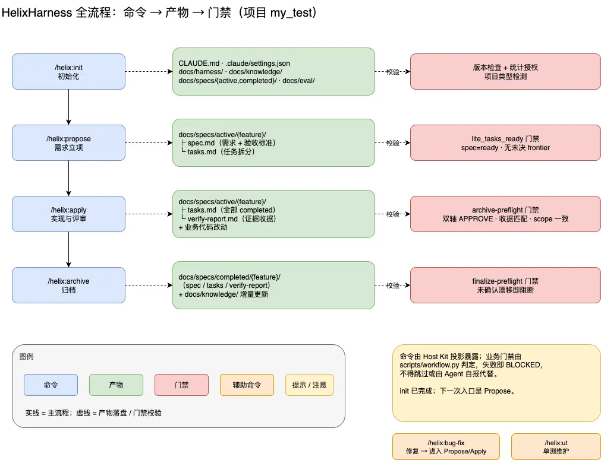

# 任务拆分是怎么做的？
- 任务拆分是 Propose 的第 4 节：从已确认的 spec.md 自动派生出 tasks.md 的垂直切片表。它不打断你、不要求二次批准，最后由一个脚本校验结构是否合法
```text
Propose
  ├─ 决策树收敛（frontier 为空）
  ├─ 共享理解确认（你回"确认"）
  ├─ 写 spec.md
  └─ 【第 4 节：自动派生 tasks.md】  ← 这里
       └─ validate-tasks 校验
            └─ spec: planning → ready
```
- 
# 架构图
