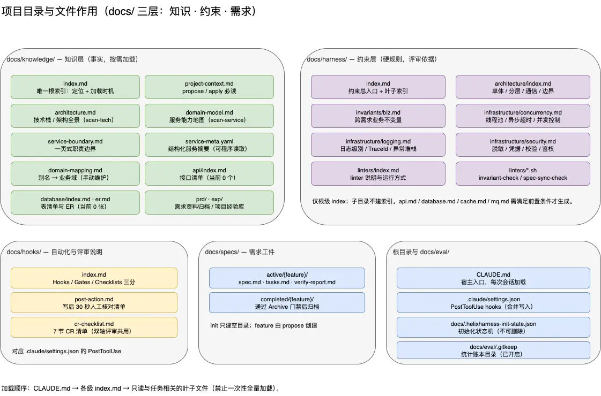
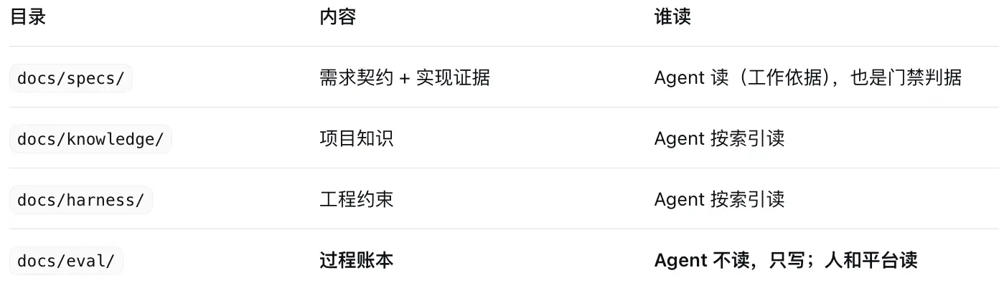

# 架构图

# 目录分工


# 在knowledge 中 index.md 唯一跟索引：定位 + 加载时机 是怎么实现的？
- 索引表是一张给人看、也给模型看的目录页，而不是可查询的结构。它类似 README 里的目录，不是数据库索引
- 格式的定义处：只有一份文档
- 
| 文件/目录 | 定位 | 加载时机 |
|---|---|---|
| invariants/biz.md | 业务不变量 | 涉及业务规则/状态流转时 |
| infrastructure/database.md | 数据库规范 | 涉及数据表/SQL/DDL时 |
- 真正“按需”的那一刻，根本没有 API 调用，是这样发生的：
```
读 index.md（一张表，几十行）
→ 对每行做语义判断：当前需求/当前 task 涉及 database 吗？
→ 命中就 Read 那个叶子
→ 再跑一次 find + stat 比时间戳，决定要不要重读（§4 时间戳缓存）
→ 输出声明「已加载：docs/harness/index.md、database.md、…」
```
- 优点
```
这不是偷懒，是有意的取舍，和它“知识必须是可评审的仓库文档”的立场一致：

零依赖：不需要跑建索引的进程、不需要 embedding 服务、不需要额外存储
人可读：新人打开 index.md 就知道这个项目有哪些知识
可评审：索引变更跟代码一起走 code review
改起来不花钱：调整加载时机只需编辑一行 Markdown
对一个主打“知识留在仓库里”的项目，这个选择是对的。
```
- 缺点
```
1）不可判定。 Agent 判断“这次涉及数据库吗”判断错了，没有任何机制会报错。漏读一个必读项、多读三个无关页，系统都认为正常。

2）索引与文件会漂移，而且没有检测。

新增了叶子文件但没加进表 → 那个文件永远不会被加载（§6 明确说“未索引文件不属于标准读取集”）
删了文件但表里还留着 → 读取失败，可能被静默忽略
“加载时机”写得含糊（“相关时”）→ 等于没写
3）平铺一张表，规模一大就退化。 协议规定“子目录不生成 index.md”，所有叶子平铺进根表。50 个文件就是 50 行，每次加载都要先读完这 50 行——本来是为了省 token 的设计，文件一多反而变成固定开销。而且没有二级导航，没法“先看目录再下钻”。

4）质量无法回检。 表格由 init 一次性生成，之后没有“重新校准”的机制。代码演进了，知识文档和它们的定位描述都停留生成那天。
```
# docs/eval 目录 再详细解释一下 是干啥的？
- 是需求级的过程账本：记录“这个需求在 propose、apply、archive 各花了多久、返工几次、走了哪些豁免”，由机器写入、给人和平台读。它不是测试报告，也不是评测结果，Agent 不读它，只写它
- 一句话收尾：docs/specs 记录“做成了什么”，docs/eval 记录“做它的过程值多少钱”。前者是业务门禁，后者是框架迭代的原料。
