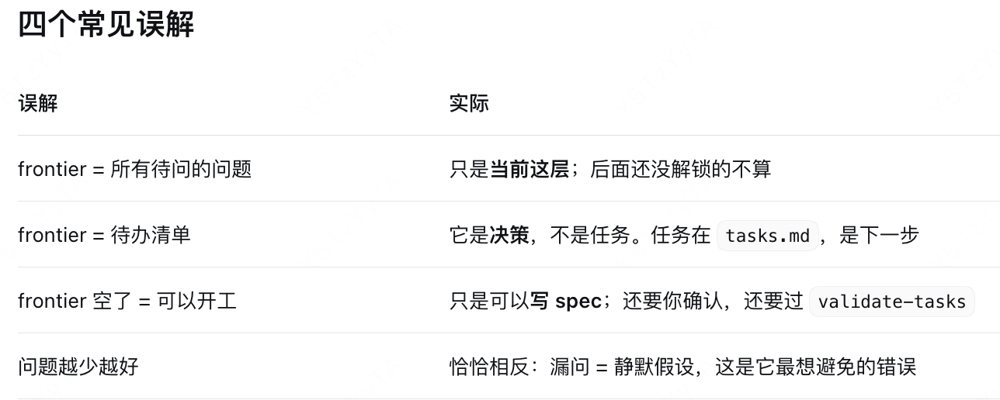
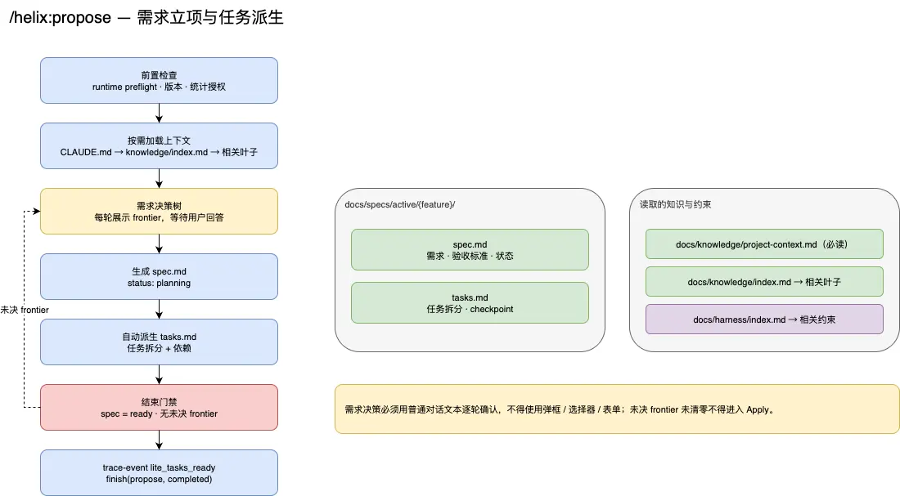

# frontier 是什么
- frontier 是“当前这一层已经能问的决策集合”，也就是决策树里已经展开的边界。
- 在 BFS 里，它指“已到达但还没展开的节点”；在 HelixHarness 里，它就是“前置条件全都定了，现在问不会白问”的那批决策。
- 一句话收尾：frontier 就是“这一轮可以问、且现在问不会白问的决策集合”；每答完一轮，边界往外推一层，直到推不出新问题——这时才算真正理解了需求。

# docs/knowledge/project-context.md 详细解释一下
- docs/knowledge/project-context.md 是这个仓库的“身份卡”：它是绿地还是存量、用什么技术栈、什么架构风格、属于哪个业务域。它在 init 时生成，并被索引标成“propose/apply 必读”，所以后续每个阶段都会默认加载它。
- 一句话收尾：它是 init 塞给 Agent 的第一段“项目自我介绍”，作用很窄但很关键——让后面每个阶段不用重新猜“这是新项目还是老系统”，从而用对评审标准。

# 架构图
