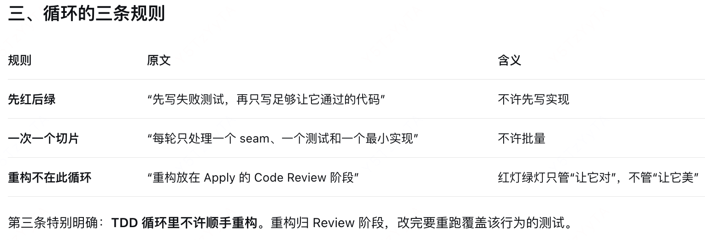

# TDD实现是指什么
- “TDD 实现”是 Apply 的第 3 节：按 skills/tdd/SKILL.md 的红灯→绿灯循环，在 Spec 已确认的“公共 seam”上，一个切片一个切片地实现。它强调先让测试失败，再让实现通过，顺序不是“写完代码补测试”。
```text
Apply
  ├─ bind-apply（记基线）
  ├─ 加载约束与知识
  └─ 【第 3 节：HelixHarness TDD 实现】   ← 这里
       └─ 每个 task：in_progress → 实现 → completed
```
- 核心概念：seam  “Seam 是被测试的公共边界：通过这个接口观察行为，而不进入实现内部。只在 seam 上测试，不测试内部结构。”

- 一句话收尾：这里的 TDD 是“在事先约定好的公共边界上，一个失败测试换一个最小实现，反复推进”；它的价值不在于“有测试”，而在于测试是先写的、期望值是独立的、只认公共行为——这三条决定了测试是规格，还是实现的复印件。
# 架构图
