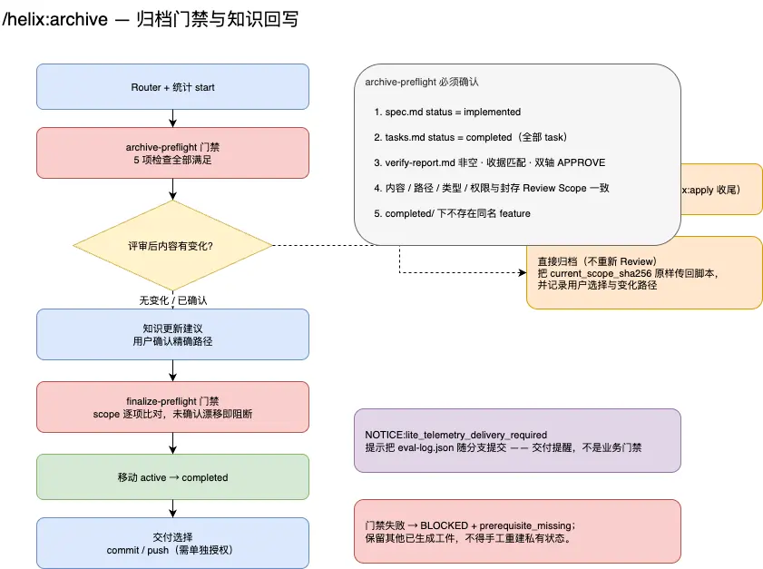

# preflight  具体解释一下
- preflight 是航空术语：起飞前的检查。特点有三个——在不可逆动作之前、按清单逐项过、任何一项不过就不许起飞。
- HelixHarness 借用这个词，含义完全一致：在执行不可逆操作前，用确定性脚本把该满足的条件过一遍。
- 一句话收尾：preflight 就是“起飞前的清单式检查”——运行时那套查环境在不在，业务那套查工件与收据对不对；检查是确定性的、只读的、失败即停的，目的是让不可逆的动作永远不需要回滚。

# 架构图
