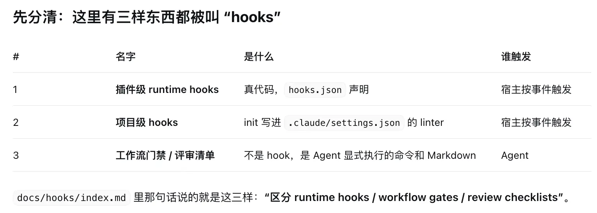
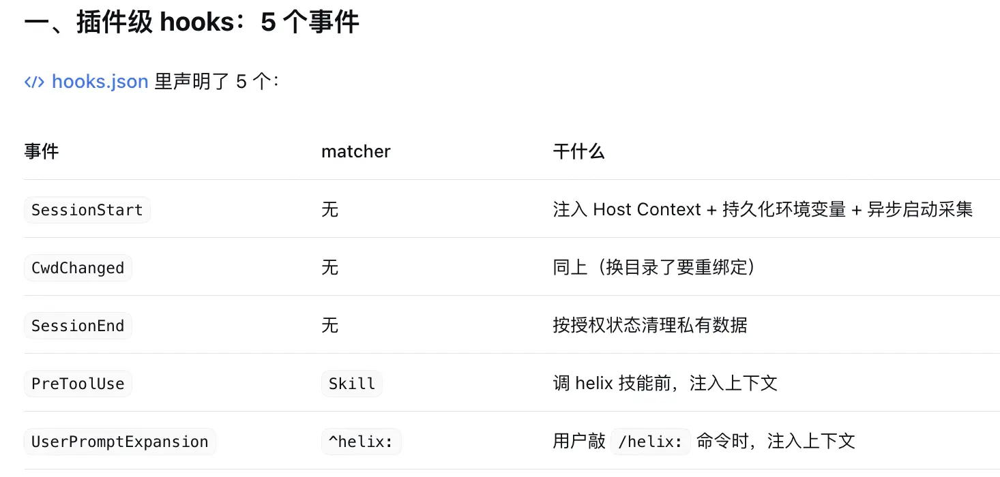
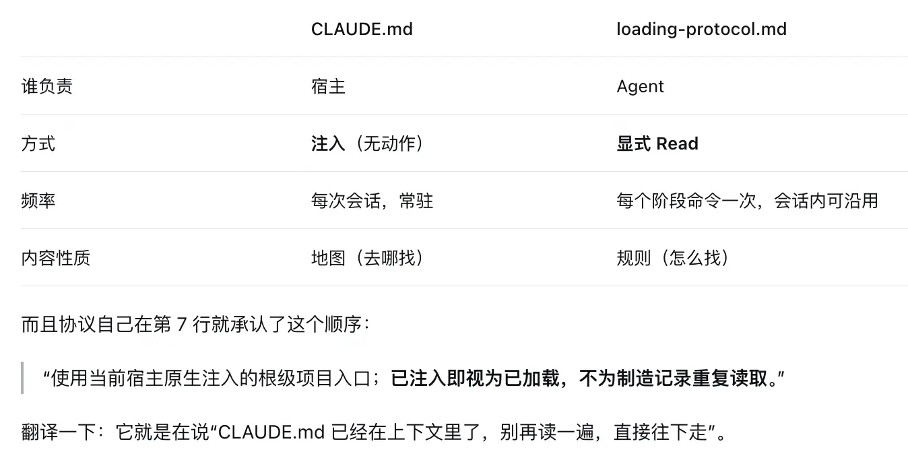
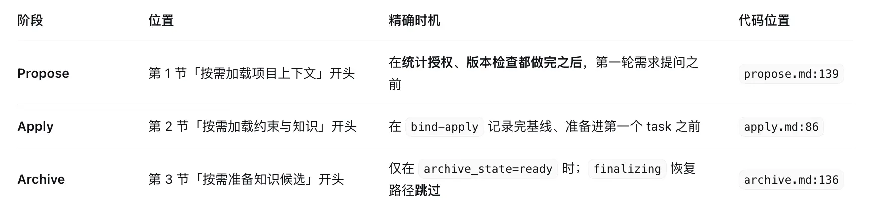
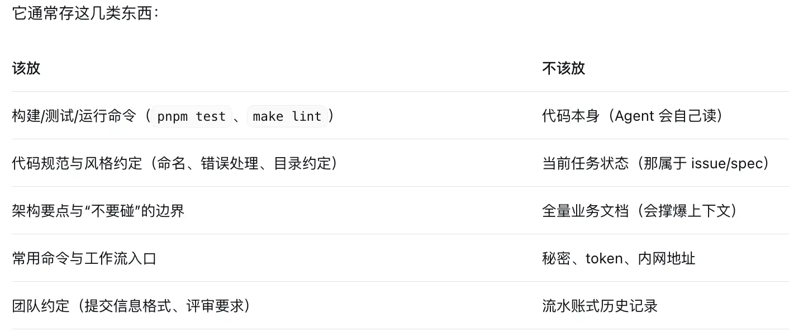
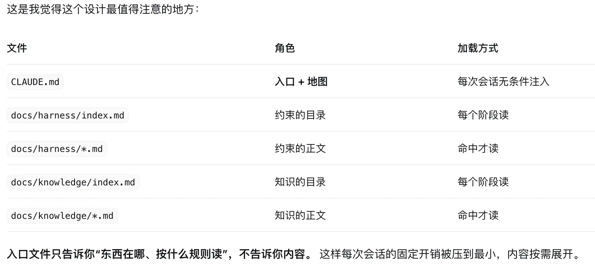
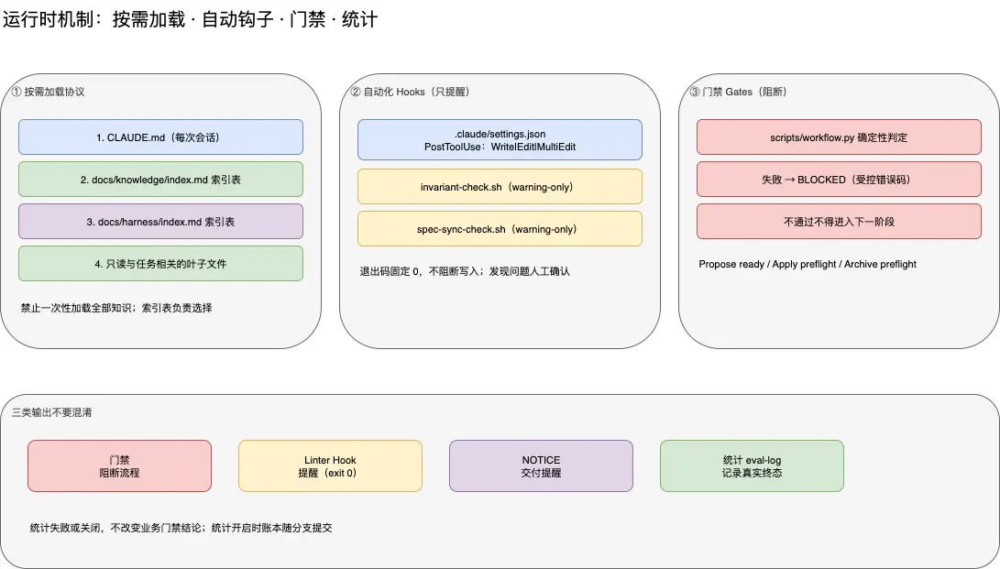

# 再详细聊聊 自动化 hooks ？ 他主要干了啥 ？ 什么时候触发的 ？


- 一句话收尾：这套 hooks 的主要职责是给 Agent 提供一个可信的起点——正确的插件根、正确的会话身份、正确的清理规则，外加每次写完文件后的轻微提醒。它不参与决策，只保障环境一致性。

# CLAUDE.md 是怎么被直接注入的 ？
- 问题出在宿主（Claude Code 客户端进程）在建立会话时把文件内容拼进了上下文，并非插件在做“注入”。
- 机制四步
```text
1. 客户端启动 / 新会话
      └─ 按约定位置找记忆文件（项目根 CLAUDE.md、用户级 ~/.claude/CLAUDE.md…）

2. 读文件，展开 @import（如果有）
      └─ 变成一段纯文本

3. 拼进上下文
      └─ 作为 system prompt 的一段（或等价的一条不可见前置内容）

4. 你的第一条消息到达时
      └─ 模型已经"看过"了，全程没有任何 tool_use
```
- 一句话收尾：CLAUDE.md 的“注入”是客户端的启动行为，不是任何插件、hook 或模型调用做的。插件只是把这份文件放在约定的位置，剩下的交给宿主——这也是为什么它“一定会被看到，但也一定会占位置”。
# CLAUDE.md 文件内容
```text
# HelixHarness 导航

## 目录导航

- `docs/harness/index.md`：项目约束入口。
- `docs/knowledge/index.md`：当前知识入口，按“文件/目录、定位、加载时机”选择相关叶子。
- `docs/specs/active/<feature>/`：当前需求；Propose 生成 `spec.md`、`tasks.md`，Apply 生成 `verify-report.md`。
- `docs/specs/completed/<feature>/`：通过 Archive 门禁后归档的三份工件。

## 关键约束速览

{{PROJECT_CONTEXT}}

## 常用命令

`/helix:init`、`/helix:propose`、`/helix:apply`、`/helix:archive`、
`/helix:ut`、`/helix:bug-fix`、`/helix:update`。
`propose --loop` 按顺序执行 Propose → Apply → Archive。

## Agent 工作规则

读取当前宿主原生入口与项目索引，按任务范围加载约束和知识。完整命令以插件 `commands/` 为准。
保留用户已有内容；实现、验证和归档必须有实际工件证据。Apply 内部执行 Standards 与 Spec 双轴评审。
归档前展示知识修改建议并按用户确认的精确范围更新；提交和推送遵循当前命令的授权规则。
```
# loading-protocol.md  和 CLAUDE.md 谁先被读取？
- CLAUDE.md 一定先被读取；它甚至不是被“读”进来的，而是被直接注入的。
```text
t=0     会话建立
        └─ 宿主自动把 CLAUDE.md 注入 system context   ← 不用 Agent 做任何动作

t=?     你敲 /helix:propose
        ├─ 单仓前置检查
        ├─ 统计授权
        ├─ 版本检查
        └─ Agent 第一次显式 Read：reference/loading-protocol.md

t=?+    按协议读 docs/harness/index.md、docs/knowledge/index.md
        └─ 再按「加载时机」读叶子，声明「已加载：…」
```
- 两者的生命周期完全不同

- 一句话收尾：CLAUDE.md 是宿主在会话第 0 秒塞进来的地图；loading-protocol.md 是 Agent 在第一次要找东西时，才去翻的目录使用说明。先有地图，再有说明书，最后才按说明书去取货

# loading-protocol.md  这个文件的内容  ？
- 本文件是项目入口与 harness/knowledge 加载行为的唯一约定。会话内已读过且文件未变化时可沿用。
```text
# 按需加载协议

本文件是项目入口与 harness/knowledge 加载行为的唯一约定。会话内已读过且文件未变化时可沿用。

## 项目入口

使用当前宿主原生注入的根级项目入口；已注入即视为已加载，不为制造记录重复读取。未注入时只检查 Host Kit 声明的根级入口路径，不搜索其他宿主或旧版本入口。缺失或冲突时声明实际路径和原因，按索引与当前代码事实调查，不自动运行 Init 或其他命令。

## 1. 通用加载流程

1. 读取 `docs/harness/index.md` 和 `docs/knowledge/index.md`（Archive 仅 knowledge）；每个目录树只有一个导航根索引。
2. 依据“文件/目录、定位、加载时机”三列表头逐行评估，只读取命中的叶子及本阶段必读项。索引缺失或格式不符时明确说明，依据代码事实调查；不猜旧格式字段，也不自动修改索引。
3. 首次及变更重读后声明 `已加载：<实际项目入口路径及状态；索引、叶子>`；未变化时声明沿用的具体范围。

## 2. 评估依据

| 命令阶段 | 判断依据 |
|---------|---------|
| propose | 当前需求、已确认决策与 Spec 涉及领域 |
| apply | 已确认 Spec、Tasks 和当前 task 的技术领域；每个 task 开始前重新评估 |
| archive | 不加载 harness；knowledge 按实际实现、验证报告及知识更新范围选择 |

## 3. 「必读」项

加载时机列含"必读"字样（如 `propose/review 必读`）→ 对应命令阶段直接加载，不走条件判断。

---

## 4. 时间戳缓存（会话内去重）

1. 首次加载后，用 `find` + `stat` 取目标目录最新修改时间作为快照
2. 后续同一目录再次加载前先比较时间戳：
   - **未变** → 跳过，声明"沿用已加载内容（文件未变更）"
   - **已变** → 重读变更文件并更新快照

---

## 5. index.md 格式规范

每个目录树只有一个根 index.md，使用统一三列表格，直接索引所有叶子文件（含子目录下的文件）：

```markdown
| 文件/目录 | 定位 | 加载时机 |
|-----------|------|---------|
| invariants/biz.md | 业务不变量 | 涉及业务规则/状态流转时 |
| infrastructure/database.md | 数据库规范 | 涉及数据表/SQL/DDL时 |
| api/index.md | 接口总览 | 涉及HTTP接口/REST/RPC时 |
```
# loading-protocol.md  什么时候被agent读取？
- 读取时机是：“即将第一次加载项目文档”的那一刻。因为读它才知道“该怎么加载”。
- 三个读取点

- 从时序上看是这样：
```text
Propose
  单仓前置检查 → 统计授权 → 版本检查 → 【读 loading-protocol】 → 读 index → 决策树
Apply
  硬前置 → bind-apply（记基线） → 【读 loading-protocol】 → 读 index+叶子 → TDD
Archive
  归档前门禁 → 提交范围确认 → 【读 loading-protocol】 → 只读 knowledge index → 知识候选
```
# CLAUDE.md（每次会话）  该文件存储的什么？
- CLAUDE.md 是**“ 每次会话开始时被自动塞进上下文的那份项目说明书”**。它本身是 prompt 的一部分，不是代码、不是状态、也不是配置——存的是“你希望 Agent 每次开工前一定知道的事”。’
- 判定标准很简单：“如果 Agent 不知道这件事，第一次动手就会犯错” → 放进去；“读代码/读文档就知道了” → 不放。
- 它是唯一绕过“按需加载”机制的文件。
- 所以它的成本结构是固定的：不管你这次要干什么，这整份文件都占着上下文的钱。 这直接决定了它必须写得极短——它是地图，不是内容。

- 它的设计哲学：只放地图，不放内容

- 一句话收尾：CLAUDE.md 存的是“每次开工前必须知道的最少必要信息”——地图、命令、几条铁律。真正的规范和知识都在 docs/harness 和 docs/knowledge 里，等被问到时才展开。

# 架构图
