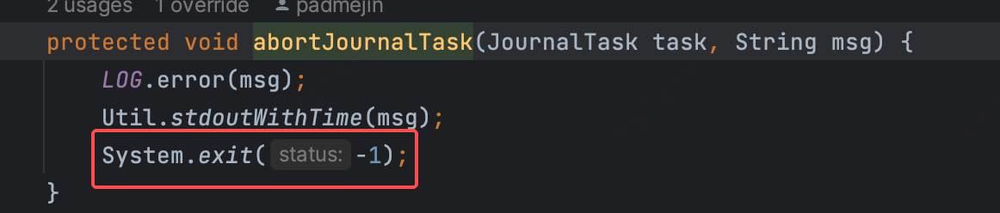
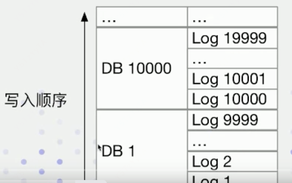

# 基本知识
- Berkeley DB Java Edition
- 分布式嵌入式kv数据库
- 不是通过服务的形式
- 而是通过api调用的形式
- 通过回放操作日志，即可重构完整的元数据

# BEBJE的作用
- 各种元数据的变更日志的持久化
- 借助 bdbje 的 Replication 机制和 Replayer 线程（回放元数据变更日志），实现元数据在多个 FE 节点上的近实时同步
- 负责实现 FE 节点的高可用，包括 Master 节点的选举及角色变更事件的监听

# BDBJE是如何存储元数据的
- 实际存储的是元数据的操作日志

- 通过回放操作日志，即可重构完整的元数据

# 写BDBJE失败为啥退出？
- 真正的元数据会存在内存中
- 在做变更的时候先操作内存中的元数据，再写BDBJE
- 如果BEBJE写失败，就要回滚内存中元数据
- 内存中的元数据状态难以回滚
- 所以一点BDBJE写入失败，JVM进程就会退出，这样的好处是
  - 内存中看到的数据和BDBJE持久化的内容完全一致
  - 通过高可用机制，即使一个节点退出，其它FE仍然可以提供服务

# rollEditLog
- 在写入日志（BEBJE）的时候，当发现写入的条数达到一定配置的时候 Config.edit_log_roll_num  默认5万
- 就会做roll edit log的操作，这个操作本质上是一个checkpoint分割点
- 比如下图中的 Config.edit_log_roll_num是1万，那么当写到一万条edit log的时候，就会BDBJE就会生成一个新的DB 10000
- 后续在做checkpoint的时候就会找到一个清晰的界限

# BEBJE的启动
# BDBJE的读取（回放）元数据

# 相关类
## BDBEnvironment
- setup 方法主要用来构建 bdbje 的 ReplicatedEnvironment 实例
- FE 启动时指定的 --helper "fe_master_host:edit_log_port" 配置，实际上是用于构造 bdbje replicationConfig，在 bdbje Replication 机制中，helper hosts 用于发现集群中 Master 节点

## BDBHA
- 实现了 HAProtocol 接口，用户获取当前集群中的节点信息及角色信息
- 主要用来支持 FE 节点信息的展示，被 ShowMetaInfoAction、HaAction 这两个 Action 使用

## BDBStateChangeListener
- 用于监听节点角色变更事件

## BDBJEJournal
- 用于读取连续的多条变更日志

# 参考文档
- 《Apache Doris 源码阅读与解析系列直播—— 第九讲 元数据管理》