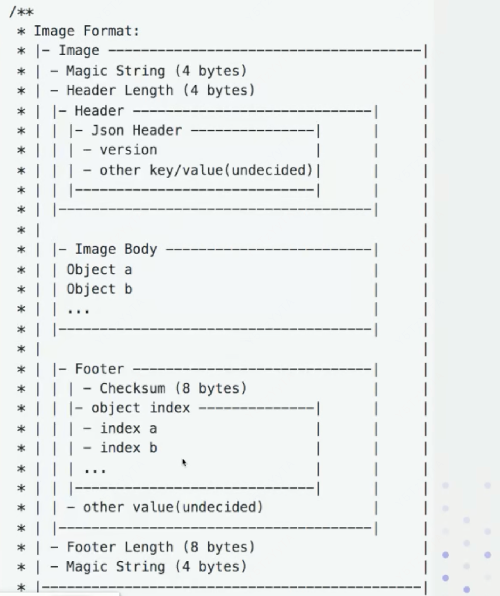

# 需要解决的问题
- 启动的时候需要回放所有的元数据日志，日志越多，回放越慢，如果解决FE的重启速度
- 单节点故障如何保障元数据高可用

# 基本知识
- Checkpoint机制解决的就是保证FE的启动速度
- 定期把元数据操作日志进行合并，形成一个image文件
- 那么在FE启动的时候先加载image文件，然后再从image中的的最后一条继续回放BDB中新的日志
- image文件本质上是FE内存中的元数据镜像，而不再是操作日志
- Checkpoint是leader节点做的
- 当元数据条数达到一定条数，会rollEditLog，就是产生一个新的BDBJE的database
- 每产生一个新的BDBJE的database就会触发checkpoint的检查逻辑，就会开始做checkpoint

# Image文件格式
