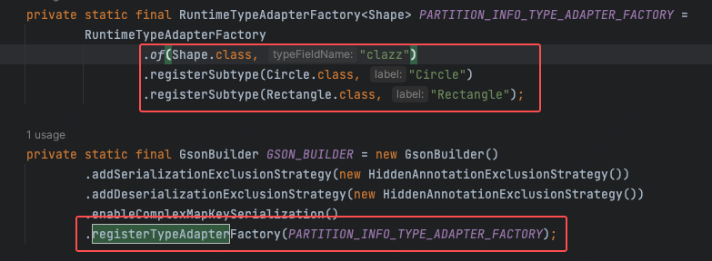
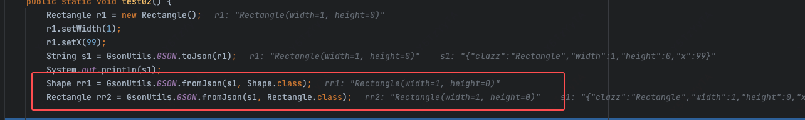

# 基本知识
- gson默认使用反射机制来进行序列化和反序列化，即反射的TypeAdapter。性能不足

# RuntimeTypeAdapterFactory
- 用于解决多态问题，即声明的类型和其运行时的类型不一致
- 当字段的类型与 GSON 在反序列化该字段时应该创建的类型不一致时，这是必要的
- 注册代码如下

- 如果没有注册，则按正常的序列化，结果如下
```text
{"width":1,"height":0,"x":99}
```
- 如果注册了，结果如下
```text
{"clazz":"Rectangle","width":1,"height":0,"x":99}
```
- 如果注册了，那么就必须按照注册格式序列化和反序列化
  - 注册的格式就是如下
```text
{"clazz":"Rectangle","width":1,"height":0,"x":99}
```
- Gson在反序列化Shape类或者 Shape 子类时，就必须要有clazz字段
- 在反序列化时 Class 类型类 添加父类 或者 子类 都可以
  - 如下所示 填写 Shape.class  和 Rectangle.class 反序列化出来的对象 都是 Rectangle


# GsonBuilder
## addSerializationExclusionStrategy
- 配置在序列化时的排除策略
- shouldSkipField 返回true时，则该字段不输出到JSON

## addDeserializationExclusionStrategy
- 配置反序列化的排除策略

## enableComplexMapKeySerialization
- Gson在序列化Map时，默认情况下是调用Key的toString方法得到它的JSON字符串的Key
- 对于简单类型和字符串类型，这没有问题
- 但是对于复杂数据对象，如果对象没有覆写toString方法，那么默认的toString方法将得到这个对象的Hash地址
- 添加了这个配置项后，Map中的key就可以使用json的序列化

## registerTypeAdapter
- 配置自定义的序列化和反序列器
- 只对特定类型有效

## registerTypeHierarchyAdapter
- 与registerTypeAdapter的区别是，其对注册的类型以及所有的子类都有效

## registerTypeAdapterFactory
- Registering a factory is useful when the type adapter needs to be configured based on the type of the field being processed.
- Gson is designed to handle a large number of factories, so you should consider registering them to be at par with registering an individual type adapter.
- 此处的重要作用就是注册 RuntimeTypeAdapterFactory 解决多态类型的处理

# 参考文档
- https://blog.csdn.net/gitblog_00051/article/details/152055464?spm=1001.2101.3001.6650.2&utm_medium=distribute.pc_relevant.none-task-blog-2%7Edefault%7EYuanLiJiHua%7EPosition-2-152055464-blog-53513878.235%5Ev43%5Epc_blog_bottom_relevance_base3&depth_1-utm_source=distribute.pc_relevant.none-task-blog-2%7Edefault%7EYuanLiJiHua%7EPosition-2-152055464-blog-53513878.235%5Ev43%5Epc_blog_bottom_relevance_base3&utm_relevant_index=5
